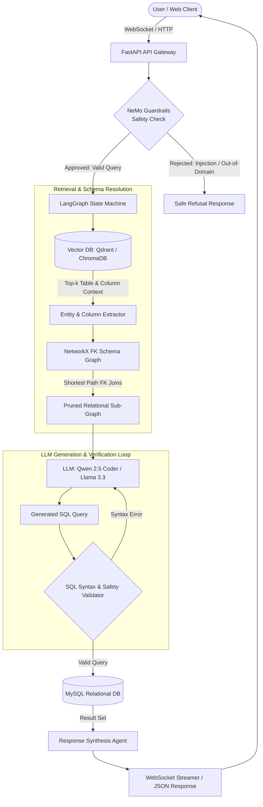

# 🏥 InsurePulse AI: Enterprise Healthcare & Insurance Conversational Intelligence

[](https://www.python.org/)
[](https://fastapi.tiangolo.com/)
[](https://github.com/langchain-ai/langgraph)
[](https://www.langchain.com/)
[](https://qdrant.tech/)
[](https://github.com/NVIDIA/NeMo-Guardrails)
[](https://opensource.org/licenses/MIT)

**InsurePulse AI** is a production-grade Conversational AI and Text-to-SQL platform built for complex enterprise Healthcare and Insurance relational databases. It translates natural language questions into accurate, performant SQL queries across 45+ relational tables, combining **Graph-based Schema Linking (NetworkX)**, **LangGraph Agentic State Machines**, **Hybrid RAG (Qdrant & ChromaDB)**, and **NVIDIA NeMo Guardrails** for query safety.

---

## 📌 Table of Contents
- [Key Architectural Highlights](#-key-architectural-highlights)
- [System Architecture](#-system-architecture)
- [Dual-Engine Text-to-SQL Pipeline](#-dual-engine-text-to-sql-pipeline)
- [Safety & Guardrails Architecture](#-safety--guardrails-architecture)
- [Tech Stack](#-tech-stack)
- [Directory Structure](#-directory-structure)
- [Getting Started](#-getting-started)
  - [Prerequisites](#prerequisites)
  - [Local Installation](#local-installation)
  - [Docker Setup](#docker-setup)
- [Configuration & Environment Variables](#-configuration--environment-variables)
- [API Reference](#-api-reference)
- [Roadmap & Contributions](#-roadmap--contributions)

---

## 🌟 Key Architectural Highlights

1. **Graph-Augmented Schema Linking (NetworkX)**:
   - Real-world relational schemas span dozens of tables with complex foreign key constraints. Passing all DDLs into an LLM exceeds context limits and causes hallucinated joins.
   - InsurePulse AI models relational foreign keys as a directed graph using **NetworkX**. It calculates shortest relationship paths between extracted entities and injects only the minimal sub-graph schema into the prompt.

2. **Self-Correcting LangGraph State Machine**:
   - Manages cyclical reasoning loops: Contextualize Query $\rightarrow$ Entity Extraction $\rightarrow$ Graph Traversal $\rightarrow$ Candidate SQL Generation $\rightarrow$ Query Checker / Dry-Run $\rightarrow$ Auto-Correction $\rightarrow$ Final SQL Execution.
   - If MySQL throws a syntax or constraint error, the state machine routes the error trace back to the LLM with contextual schema hints for automated query self-healing.

3. **Enterprise Defense with NVIDIA NeMo Guardrails**:
   - Inspects queries before LLM inference to intercept SQL injection vectors, prompt jailbreaks, and destructive mutations (`DROP`, `DELETE`, `UPDATE`, `ALTER`).
   - Ensures execution safety by enforcing read-only analysis.

4. **Hybrid RAG & Vector Indexing (Qdrant & ChromaDB)**:
   - Employs `BAAI/bge-base-en-v1.5` embeddings and Cross-Encoder re-rankers (`ms-marco-MiniLM-L-6-v2`) to index table metadata, column dictionaries, enterprise FAQs, and internal API documentation.

5. **Real-Time Bi-Directional WebSockets**:
   - Implements persistent WebSocket streaming alongside standard FastAPI REST endpoints, providing token-by-token streaming, query progress markers, and session history management.

---

## 🏗️ System Architecture



---

## ⚡ Dual-Engine Text-to-SQL Pipeline

InsurePulse AI provides two configurable runtime architectures via `APPROACH`:

| Feature | Approach 1: Semantic Vector Text-to-SQL | Approach 2: Graph-Augmented Schema Flow |
| :--- | :--- | :--- |
| **Primary Mechanism** | Contextualized Vector RAG + Few-Shot Prompting | NetworkX Foreign-Key Graph + LangGraph StateGraph |
| **Schema Discovery** | Dense vector similarity over table comments | Dynamic topological traversal & shortest-path join routing |
| **Best For** | Single-table & 2-3 table straightforward queries | Deep multi-hop relational queries (4+ tables with intermediate FKs) |
| **Self-Healing** | Single-pass query checker prompt | Multi-pass iterative state feedback graph |

---

## 🛡️ Safety & Guardrails Architecture

Healthcare and insurance queries handle sensitive medical and policy records. The system utilizes multiple defense layers:
- **Input Sanitization**: NVIDIA NeMo Colang rails filter prompt injection attempts.
- **Strict Read-Only Enforcement**: Read-only query classification rejecting Data Manipulation Language (DML) statements.
- **Session Authentication**: JWT Bearer token authentication with SHA-256 encrypted password storage.

---

## 🛠️ Tech Stack

- **Core Backend**: FastAPI, Starlette, Uvicorn, Pydantic v2
- **Agent Orchestration**: LangGraph, LangChain, LangSmith
- **Guardrails**: NVIDIA NeMo Guardrails
- **Vector Search**: Qdrant Client (Async), ChromaDB, Sentence-Transformers (`BAAI/bge-base-en-v1.5`)
- **Graph Processing**: NetworkX, Grandalf
- **Relational Databases**: MySQL, SQLAlchemy 2.0, SQLite (Session Memory)
- **Supported LLMs**: Ollama (Qwen 2.5 Coder 14B, Llama 3.2 3B), Nebius Studio / OpenAI API Compatible endpoints
- **Frontend**: HTML5, Vanilla JavaScript, CSS3, WebSockets, Jinja2 Templates

---

## 📁 Directory Structure

```text
insurance_chatbot/
├── api/                        # FastAPI route definitions and dependencies
│   ├── api_v1/
│   │   ├── endpoints/          # REST & WebSocket route handlers
│   │   │   ├── auth_apis.py    # Client & user registration, token generation
│   │   │   ├── chatbot_api.py  # Synchronous chat & document ingestion APIs
│   │   │   └── websockets.py   # Full-duplex WebSocket chat handler
│   │   └── api.py              # Aggregated v1 API router
│   └── deps.py                 # SQLAlchemy database session dependency
├── config/                     # Configuration schemas & Guardrails configs
│   ├── huggingface/            # NeMo Guardrails HF rules & Colang flows
│   ├── krutrim_ola/            # NeMo Guardrails cloud LLM rules
│   ├── ollama/                 # NeMo Guardrails local Ollama rules
│   ├── careloop_*.json         # Database schema, foreign keys & graph metadata
│   └── config_env.json         # Sanitized default application settings
├── core/                       # Error handling and response formatters
├── dao/                        # Data Access Objects (User, Token, Chat history)
├── data/                       # Local schema data copies for ingestion
├── Documents/                  # Schema information loaders and table extractors
├── logs/                       # Rotating file & socket logging infrastructure
├── Model/                      # SQLAlchemy ORM models (User, Client, Token)
├── prompts/                    # System prompts, SQL correction templates & Few-shots
│   ├── Approach_1_prompts/     # Prompts for vector-based Text-to-SQL
│   └── Approach_2_prompts/     # Prompts for graph-augmented Text-to-SQL
├── services/                   # Core business logic & agent engines
│   ├── CRMChatbotFlow.py       # Approach 1 state & execution pipeline
│   ├── CRMChatbotGraphFlow.py  # Approach 2 LangGraph state machine & graph routing
│   ├── Schema_graph_algorithm.py # NetworkX graph algorithm for schema paths
│   ├── Text2SQL_Manager.py     # High-level chatbot orchestrator
│   ├── nemoguardrails_manager.py # NVIDIA NeMo Guardrails integration
│   ├── ingest.py               # Vector database document ingestion
│   └── websocket_manager.py    # Active WebSocket connection manager
├── settings/                   # Global settings & environment parameter loader
├── static/                     # Frontend UI assets (CSS, JS, Images)
├── templates/                  # Jinja2 HTML templates (Homepage, Login)
├── utilities/                  # VectorDB embeddings, encryption, auth helpers
├── .env.example                # Template for environment configuration
├── .gitignore                  # Git ignore rules
├── Dockerfile                  # Production Docker container build
├── main.py                     # Application entry point
├── migrate.py                  # Database schema migration script
└── requirements.txt            # Python package dependencies
```

---

## 🚀 Getting Started

### Prerequisites
- Python 3.10+
- MySQL Server (or Docker container)
- Ollama (optional, for local LLM inference)

### Local Installation

1. **Clone the repository**:
   ```bash
   git clone https://github.com/Kunal-63/insurance-ai-text2sql.git
   cd insurance-ai-text2sql
   ```

2. **Create and activate a virtual environment**:
   ```bash
   python -m venv venv
   # On Windows:
   .\venv\Scripts\activate
   # On Linux/macOS:
   source venv/bin/activate
   ```

3. **Install dependencies**:
   ```bash
   pip install --upgrade pip
   pip install -r requirements.txt
   ```

4. **Configure Environment Variables**:
   Copy the example environment file and update your credentials:
   ```bash
   cp .env.example .env
   ```

5. **Run Database Migrations (Initial Setup)**:
   ```bash
   python migrate.py
   ```

6. **Start the Application**:
   ```bash
   python main.py
   ```
   The application will start on `http://localhost:5559`.
   - Web Chat UI: `http://localhost:5559/`
   - Interactive Swagger API Docs: `http://localhost:5559/docs`

---

## 🐳 Docker Setup

Run the entire system in a lightweight container:

```bash
# Build the Docker image
docker build -t insurepulse-ai:latest .

# Run the container
docker run -d -p 5559:5559 --name insurepulse --env-file .env insurepulse-ai:latest
```

---

## ⚙️ Configuration & Environment Variables

| Variable | Default | Description |
| :--- | :--- | :--- |
| `APPROACH` | `1` | `1`: Semantic Vector Text-to-SQL, `2`: Graph-Augmented Flow |
| `MODEL` | `1` | `1`: Local Ollama, `2`: Cloud LLM endpoint |
| `VECTOR_DB` | `2` | `1`: ChromaDB, `2`: Qdrant Client |
| `OLLAMA_MAIN_MODEL` | `qwen2.5-coder:14b-instruct-q8_0` | Model name for SQL generation in Ollama |
| `OLLAMA_BASE_URL` | `http://localhost:11434` | Ollama service base URL |
| `DB_HOST` | `127.0.0.1` | Target MySQL host |
| `DB_NAME` | `insurance_db` | Target MySQL database name |
| `LANGSMITH_TRACING` | `false` | Enable LangSmith tracing for LLM monitoring |

---

## 📡 API Reference

### Health Check
- `GET /api/ping`: Server health and readiness check.

### Authentication
- `POST /api/register_client`: Register an enterprise client.
- `POST /api/generate_token`: Authenticate user and receive a JWT Bearer token.

### Chat & Streaming
- `POST /api/chat`: Send a synchronous query and receive structured SQL and natural language explanation.
- `WebSocket /api/ws/chat`: Full-duplex real-time streaming endpoint with state management.

### Data Ingestion
- `POST /api/document_ingestion`: Ingest database schema definitions and FAQs into Qdrant/ChromaDB.

---

## 📄 License
This project is licensed under the MIT License - see the LICENSE file for details.
